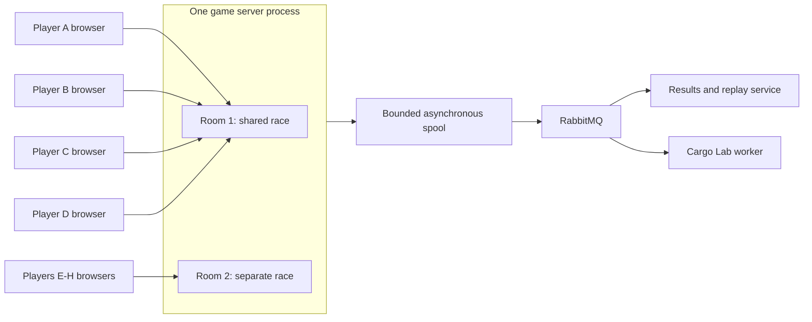

# Infrastructure, services and acquisition plan

Planning baseline, October 21, 2026. No paid resources, domain, asset downloads or deployment have been created by this plan. The owner is comfortable paying for suitable infrastructure; use this inventory to provision when implementation and access are ready.

## Recommended first deployment

Use the offered VPS if it provides administrator access, persistent SSD storage and sufficient measured CPU/memory. Starting hypothesis: 4 vCPU / 8 GiB. Otherwise use AWS Lightsail Linux General Purpose 4 vCPU / 16 GB, preferably Singapore subject to availability and measured player latency. One host is enough for the initial architecture; capacity is earned through testing, not the number of Kubernetes pods.

Public traffic: browser HTTPS/WSS -> TLS ingress -> static game frontend, Colyseus authority and results API. The authority has a separate physics world per private four-player room. It sends bounded background records to its spool writer; RabbitMQ routes persisted work to results/replay and Cargo Lab. No broker or external API sits in the input-to-physics path.

Both rooms use the same rules/code, but their bodies, inputs, timers and scores are separate. Players within one room collide; players in different rooms cannot meet. The diagram shows supported architecture, not a claim that two rooms already meet performance targets.

## Service inventory and ownership

| Component | Deployment | Why it exists / completion owner |
| --- | --- | --- |
| Frontend | Vite/Three.js static build on same host | One camera per online player; two cameras in local mode. #48, #49, #56 |
| Game authority | One Node/Colyseus process, one replica | Rooms, fixed 60 Hz simulation, validated controls and official outcomes. #49, #50 and room-isolation task |
| Results/replay API | Separate process, own SQLite volume | Durable results, replay retrieval and job status. #52, #53 |
| Cargo Lab | One bounded worker initially | Run the shared simulation asynchronously with immutable job keys. #54, #55 |
| RabbitMQ | One internal broker with persistent volume | Confirms, acknowledgements, retry/dead-letter queues. #53, #55 |
| Spool writer | Dedicated worker thread/process, game-owned SQLite volume | Filesystem/database calls cannot block the simulation event loop. #53 |
| K3s + ingress | One host, pinned versions | Repeatable placement, probes, limits and worker restart. #57, #58 |
| OpenTofu + cloud-init | Versioned provider/host definitions | Provision/recreate firewall, host and persistent resources. #57 |
| CI and container registry | GitHub Actions + GHCR | Test/build images with immutable tags/digests; record storage/minute usage. #57, #60 |
| DNS + TLS | Existing subdomain preferred, ACME issuer | Public HTTPS/WSS endpoint; no new domain required if an owned subdomain exists. #57 |
| Backup destination | Off-host archive/object storage | Restore results/replays and config after host loss. #57, #62 |

No runtime LLM, paid AI service, accounts provider, managed database, Redis, managed Kubernetes, external matchmaking service or analytics SaaS is required. The user's AI credits are optional for development/cosmetics only. Open-source components carry their own licenses; pin and record versions in the dependency inventory at implementation.

## Cost envelope (USD, estimates)

| Item | Planning amount | Notes |
| --- | --- | --- |
| Offered VPS | $0 if provided | Confirm resources, region, retention and access; not yet available to this project. |
| Paid fallback host | $84/month listed | Lightsail Linux General Purpose public-IPv4 4 vCPU / 16 GB / 320 GB SSD. Confirm selected region/bundle before apply. |
| Smaller trial option | $44/month listed | 2 vCPU / 8 GB. Use only if measured game plus broker/worker load passes; this is not 4 vCPU. |
| Backup storage / snapshots | $5-15/month allowance | Estimate based on small retained replay volume, not a provider quote. Avoid storing every debug trace forever. |
| CI/registry | $0-10/month allowance | Estimate; inspect account quota and private-package storage before relying on free usage. |
| Domain | Existing subdomain $0; new name $10-20/year allowance | Registration price depends on name/provider. DNS ownership is still needed. |
| Art/audio | $0 baseline; optional $0-30 once | Verified CC0 shortlist plus original primitives; purchase only if it saves work. |

Recommended working allowance: approximately **$90-110/month before taxes, excess transfer and optional domain/art**, using the $84 host. This is an estimate, not a spending commitment or a bill cap. Set account alerts at $75 and $100; alerts do not prevent charges. Destroy unused resources after the event and verify disks/snapshots/IP allocations separately. No free-tier credit is assumed.

Pricing source checked October 21: [AWS Lightsail pricing](https://aws.amazon.com/lightsail/pricing/). K3s' own [minimum requirements](https://docs.k3s.io/installation/requirements) exclude application workloads. Total sizing and region suitability require measurement.

## Resource and capacity policy

Initial hypotheses on the 4-vCPU host: game process request 1 CPU / 1 GiB, limit 2 CPU / 2 GiB; one analysis worker request 0.25 CPU / 512 MiB, limit 0.75 CPU / 1 GiB; broker request 0.25 CPU / 512 MiB, limit 0.5 CPU / 1 GiB; results request 0.1 CPU / 256 MiB, limit 0.25 CPU / 512 MiB. Leave host/K3s/ingress headroom. These are tuning starting points, not a reservation guarantee; CPU throttling and event-loop delay must be measured. On smaller hosts recalculate rather than copying these limits.

Public room cap begins at one. In staging, run two rooms with four clients each and a busy worker; measure aggregate tick work, event-loop delay, correction spikes, memory and client FPS for at least 15 minutes. Require p95 total authority step work below 16.7 ms and no growing backlog, with spike/overrun data recorded. A slow tick does not advance the clock by skipping physics; bounded catch-up plus admission refusal prevents unbounded overload. Reduce worker concurrency/cap before adding infrastructure. Per-room isolation prevents state leakage, not shared-process failure or CPU contention.

Observe room count, rejected joins, tick durations/overruns, reconnects, snapshot sizes, queue depth/age, worker failures, disk/spool usage and persistence lag. Start with structured logs and a small protected operator view; no extra monitoring cluster is required. One-worker restart is required evidence; a two-worker run is an experiment and can be rejected if it harms races.

## Access and deployment checklist

Issue #57 owns this sequence; these are work steps, not completed resources:

1. Record provider/account, region, supplied-VPS details or selected paid plan, SSH public key, DNS control and budget alerts. Obtain credentials through the approved secret channel, never issue bodies or Git.
2. Pin compatible tool/runtime versions and publish reviewed images. Restrict CI token scope; use short-lived cloud credentials where supported. Store OpenTofu state encrypted with controlled access; never commit state/kubeconfig/secrets.
3. Apply reviewed host/firewall/storage definitions, bootstrap K3s and install workloads. Only 80/443 public; administration restricted to the operator. Broker ports/UI, SQLite and cluster API stay private.
4. Attach separate persistent volumes with one SQLite writer per database. Set bounded spool and queue caps, result retention (initial 7 days) and keep selected demo replays until after the event. Use SQLite online backup or a consistent stopped snapshot, not a raw copy of an active database file.
5. Verify TLS renewal, direct WebSocket upgrades and idle timeouts; run two real-browser races. Test disk-full admission refusal, broker outage and worker restart.
6. Restore a committed result/replay onto a replacement test environment. A host crash aborts live races; backup does not promise resurrection of in-memory games.
7. Drain rooms before deployment: stop new admissions, let races finish, then restart. No HPA for the authority and no simultaneous old/new ownership of a room. Keep prior image digests for rollback.
8. Package the same images/assets for Compose offline use, document start/reset and teardown, and record what still incurs costs after shutdown.

## Readiness status

Ready now: product direction, source shortlist, service boundaries, budget estimate and implementation backlog. Still needed at deployment: host/account access, chosen region/plan, DNS name, secret setup and real capacity/restore evidence. Asset pack inspection and per-file manifest remain in #45. No infrastructure account access is needed to finish this planning PR.
